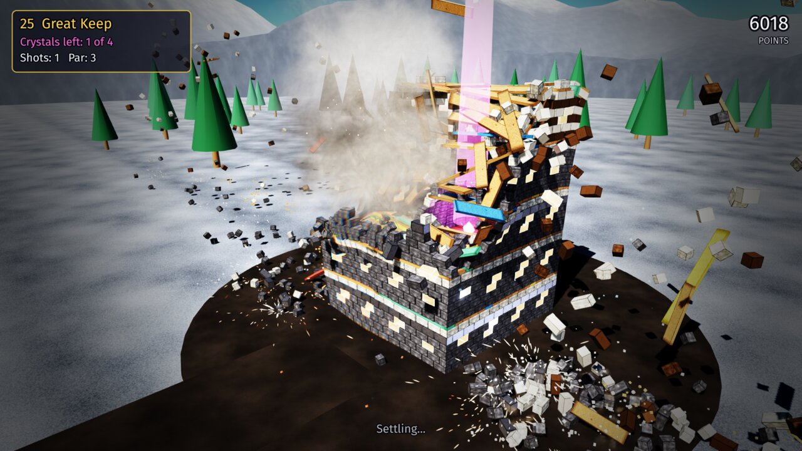

# even-more-cartwheel-examples

[](https://github.com/monteslu/even-more-cartwheel-examples/actions/workflows/ci.yml)

Even more games built with
[cartwheel-engine](https://github.com/monteslu/cartwheel-engine), a 2D and 3D
game engine in C, after the ones in
[cartwheel-examples](https://github.com/monteslu/cartwheel-examples) and
[more-cartwheel-examples](https://github.com/monteslu/more-cartwheel-examples).
Each game is written to push the engine, and the generic fixes it finds go back
into the engine.

The games ship as [wasmcart](https://github.com/wasmcart/wasmcart) carts
(`.wasc`): one file per game that runs in a browser, in Node, in a native
player and in RetroArch, with GL and WebGPU in the same cart.

## The games

### towers


A tower defense game for one to four players on one screen (working title).
Each player's cursor hops between the build pads in their own share of the
map, and the face buttons build four towers laid out as a diamond round it:
chain lightning, frost, a ramping beam and a mortar, each upgradable to level
3. Waves of eight creep kinds grow into the thousands, with a boss every tenth
wave. 30 maps in six themes, each checked in CI: the path, the pads, fair
shares, grounding, the baked light and a clear by two bots.

### pinball


Pinball for one to four players taking turns (working title), on three
original tables: Coral Deep, Star Foundry and Neon Fair. Ramps, pop bumpers,
drop targets, four modes per table, a three-ball multiball, nudge and tilt, and
a saved top five per table. The ball runs on the game's own solver, swept and
substepped so it never passes through a wall or a flipper at any speed.

### demolition



A physics destruction game for one to four players taking turns (working
title). Towers, walls, bridges, castles, scaffolds, stepped pyramids and keeps
of wood, stone, glass and steel, up to a few thousand blocks each, stand in
settings of their own (highlands, a meadow, a river gorge, sea cliffs, a
quarry, desert mesas, a snowy pass). A launcher fires shot, heavy balls and
charges at the crystals hidden inside; blocks break into pieces, dust and
shards and the structures come down on the engine's Box3D. 30 levels, each
checked to stand still for a minute, float nothing and fall to the bot within
par.

More games are on the way.

## Building

```sh
scripts/fetch-deps.sh     # the pinned engine SDKs (scripts/deps.lock)
scripts/build.sh          # build/native and build/cart-wgpu (the carts)
```

`AGENTS.md` has the test commands and the rules for showing controls.

## License

MIT, see `LICENSE`. Each game's `CREDITS` file lists what it builds on.
