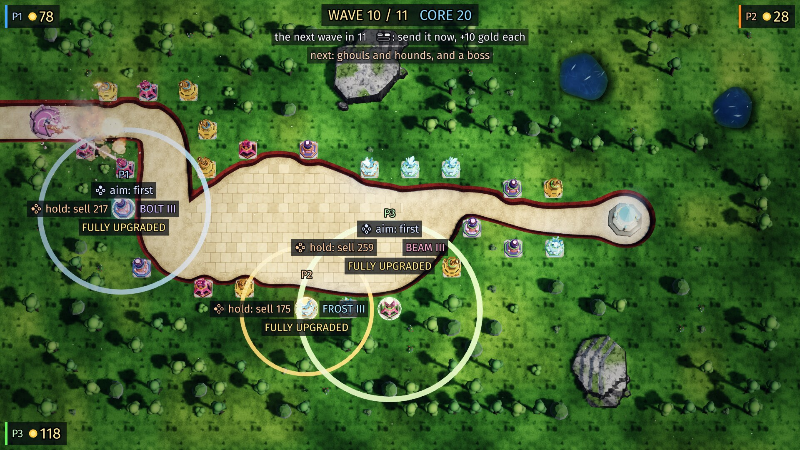
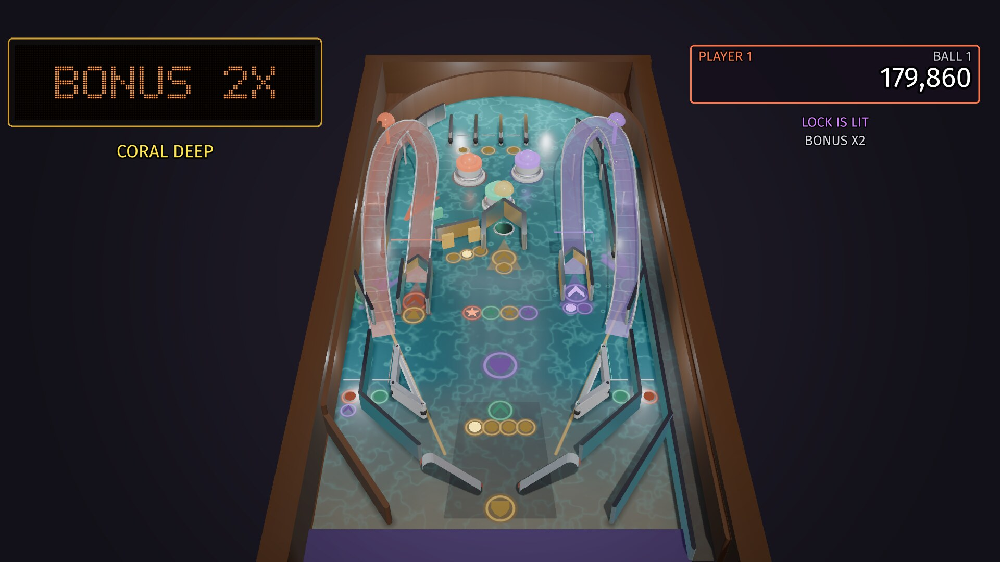
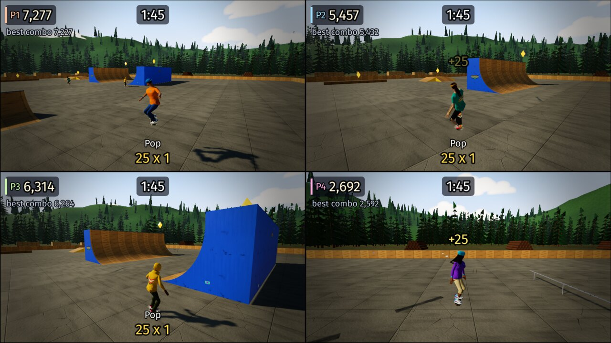
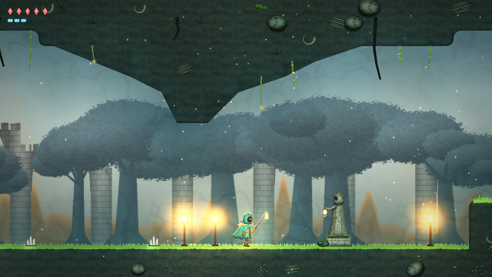
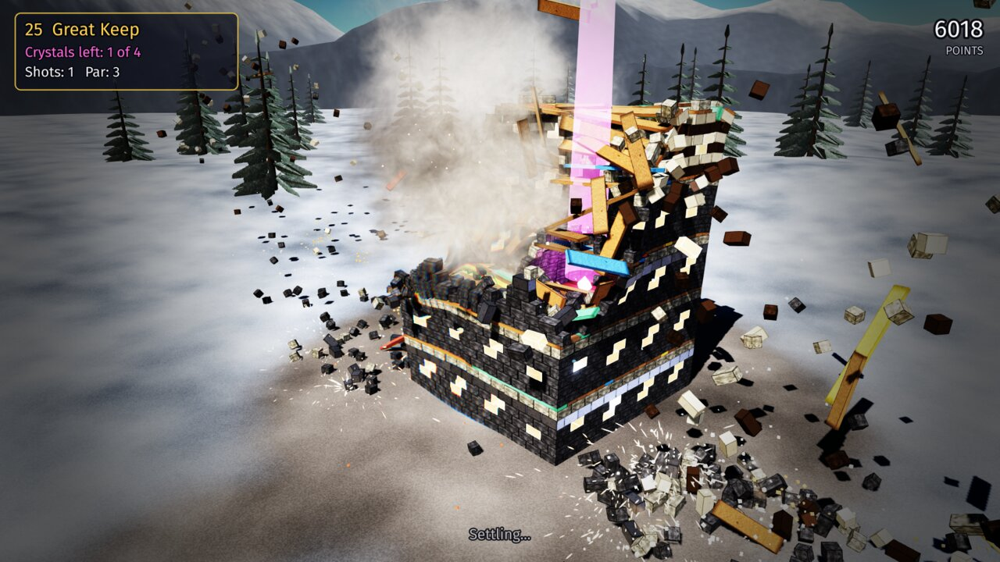
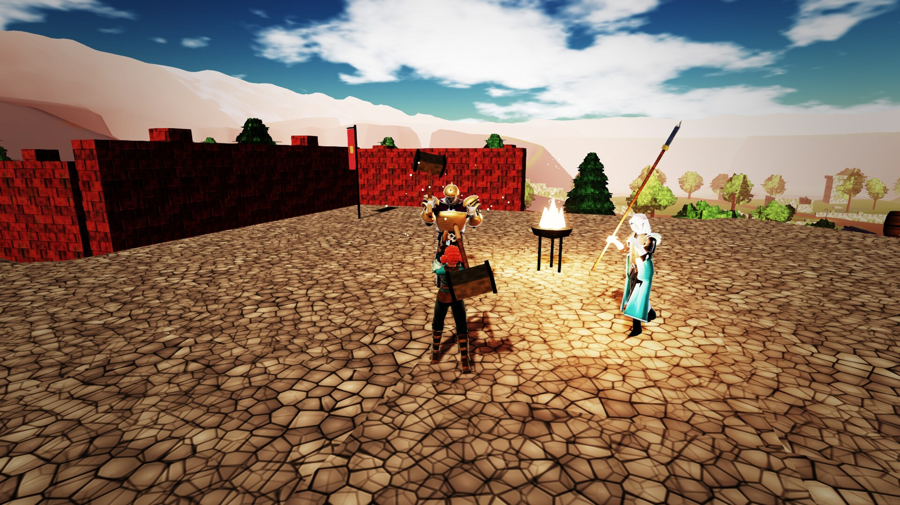
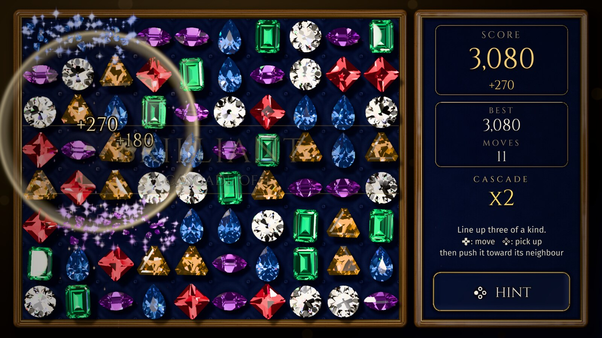

# even-more-cartwheel-examples

[](https://github.com/monteslu/even-more-cartwheel-examples/actions/workflows/ci.yml)

Even more games built with
[cartwheel-engine](https://github.com/monteslu/cartwheel-engine), a 2D and 3D
game engine in C, after the ones in
[cartwheel-examples](https://github.com/monteslu/cartwheel-examples) and
[more-cartwheel-examples](https://github.com/monteslu/more-cartwheel-examples).
Each game is written to push the engine, and the generic fixes it finds go back
into the engine.

The games ship as [wasmcart](https://github.com/wasmcart/wasmcart) carts
(`.wasc`): one file per game that runs in a browser, in Node, in a native
player and in RetroArch, with GL and WebGPU in the same cart.

## The games

### towers



A tower defense game for one to four players on one screen (working title).
Each player's cursor hops between the build pads in their own share of the
map, and the face buttons build four towers laid out as a diamond round it:
chain lightning, frost, a ramping beam and a mortar, each upgradable to level
3. Waves of eight creep kinds grow into the thousands, with a boss every tenth
wave. 30 maps in six themes, each checked in CI: the path, the pads, fair
shares, grounding, the baked light and a clear by two bots.

### pinball



Pinball for one to four players taking turns (working title), on three
original tables: Coral Deep, Star Foundry and Neon Fair. Ramps, pop bumpers,
drop targets, four modes per table, a three-ball multiball, nudge and tilt, and
a saved top five per table. The ball runs on the game's own solver, swept and
substepped so it never passes through a wall or a flipper at any speed.

### skate



Skateboarding for one to four players in split screen (working title), in five
original parks, each with its own setting to the horizon and its own light: a
concrete park with a deep bowl by a beach boardwalk at golden hour, a street plaza
with stairs and handrails in a city block, a mega ramp out under a big sky,
rooftops over a downtown street at sunset and a yard of wooden ramps in a lumber
yard among pine hills. Each park is lightmapped.
Flips, grabs, spins, grinds and manuals link into combos (a bail loses them);
free skate, a two-minute score attack with each park's goals and high score,
and score battles. The board runs on the game's own controller, substepped and
swept against the park's triangles, so a quarter pipe gives back exactly the
height its speed earns; every park is checked in CI: nothing floats and a bot
skates every line.

### Lanternfall



A 2D exploration platformer for one player, with a drop-in second: the
lanterns of the old city have gone out, and the hooded lamplighter wakes its
beacons again across one great underground world of 13 regions and 356 rooms,
where each of seven abilities (a second jump, a dash, a wall climb, swimming, a
grapple and more) opens ways you could not take before. Six wardens, shrines that save and
carry you between them, and a map that fills in as you go. It is drawn with the
engine's 2D renderer: lit sprites, soft shadows, bounced light, light shafts,
bloom and a colour grade per region. A checker proves the world can be finished
in ability order with no dead ends, and a bot plays it through to the end.

### Destructo



A physics destruction game for one to four players taking turns. Towers,
walls, bridges, castles, scaffolds, stepped pyramids and keeps of wood,
stone, glass and steel, up to a few thousand blocks each, stand in
settings of their own (highlands, a meadow, a river gorge, sea cliffs, a
quarry, desert mesas, a snowy pass). A launcher fires shot, heavy balls and
charges at the crystals hidden inside; blocks break into pieces, dust and
shards, red powder kegs set each other off, and the structures come down on
the engine's Box3D. A level is judged once the dust has settled: the third
star is for bringing the structure down, and the last shot can be watched
again in slow motion. Free fire opens every structure with ammunition without
end. 30 levels, each checked to stand still for a minute, float nothing and
fall to the bot within par.

### Ember Throne



A third-person action adventure through one connected world for one player,
with a second able to drop in. The wanderer gathers the Sun Key and the Moon Key
to open the Ember Keep and face the Ember King on his throne. Eight regions on one 640 m
terrain, from a green hollow and an amber canyon to snowy heights over a cliff
path, a lantern-lit underway, a spire with a stair round it and a wood of giant
glowing mushrooms, joined so that the way back is often a shortcut. Lock-on
sword fights with light and heavy cuts, rolls and stamina; foe groups with
readable wind-ups and three bosses; hearts, stamina charms, keys and a maul
that breaks cracked stone open new routes. A bot plays the whole game in CI,
nothing floats, and every region passes a look check.

### jewels



A calm, untimed match-three for one player, readable from a couch (working
title): swap two neighbouring stones to line up three or more. The board never
moves unless the player moves it; an illegal swap springs back and costs
nothing, the hint is free, a board with no move left reshuffles itself, and
cascades resolve slowly enough to follow. Six kinds of stone, each its own cut
and silhouette as well as its own colour (a princess, a trillion, an emerald
cut, a pear, a marquise and a round brilliant), ray traced per pixel through
their facet planes with Fresnel at every face, total internal reflection,
absorption through the body and spectral fire, in a studio of soft boxes and
small hot lamps. Clears break the stones into traced shards, and the effects
grow with the size of a clear and each step of a cascade. Pad, touch and mouse
are equal paths. The rules are checked move for move against the original Lua
game.

More games are on the way.

## Building

```sh
scripts/fetch-deps.sh     # the pinned engine SDKs (scripts/deps.lock)
scripts/build.sh          # build/native and build/cart-wgpu (the carts)
```

`AGENTS.md` has the test commands and the rules for showing controls.

Every cart's manifest says which version it is, and the build works it out
from the checkout (the engine's `cw_add_app`): a build of a `v*` tag is that
version (`0.9.0`), any other build the last tag plus the commit
(`0.9.0-dev.g1a2b3c4`), so a cart built locally or from `main` is never taken
for a release. Pushing a `v*` tag builds the carts again at the tag, checks
that every one carries the tag's version (`tests/cart-version.mjs`), and
publishes them as a GitHub release, its notes taken from
[CHANGELOG.md](CHANGELOG.md). The tagged commit must have a green run on
`main`.

## License

MIT, see `LICENSE`. Each game's `CREDITS` file lists what it builds on.
